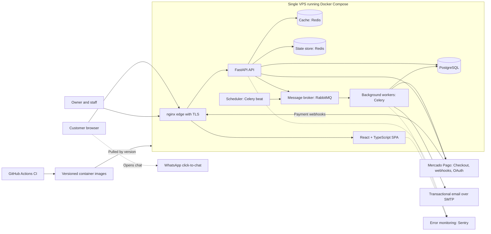
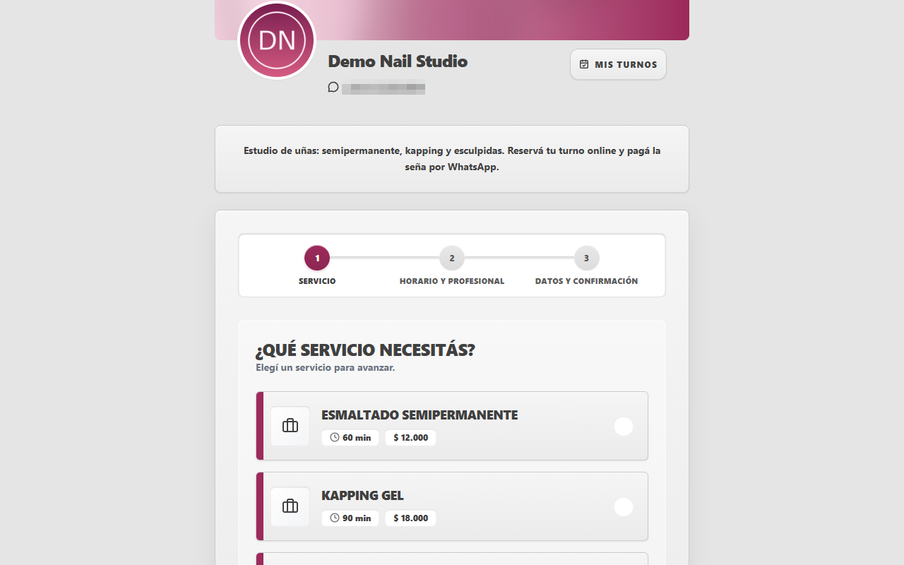
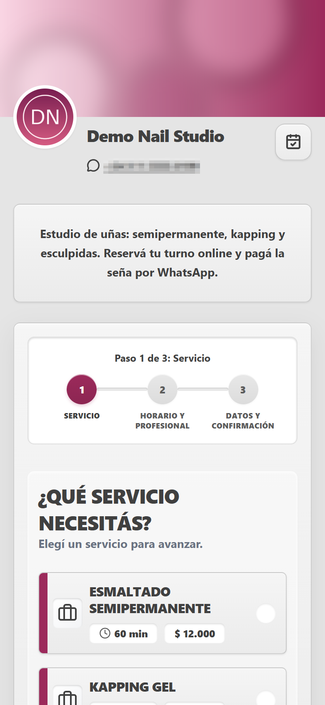
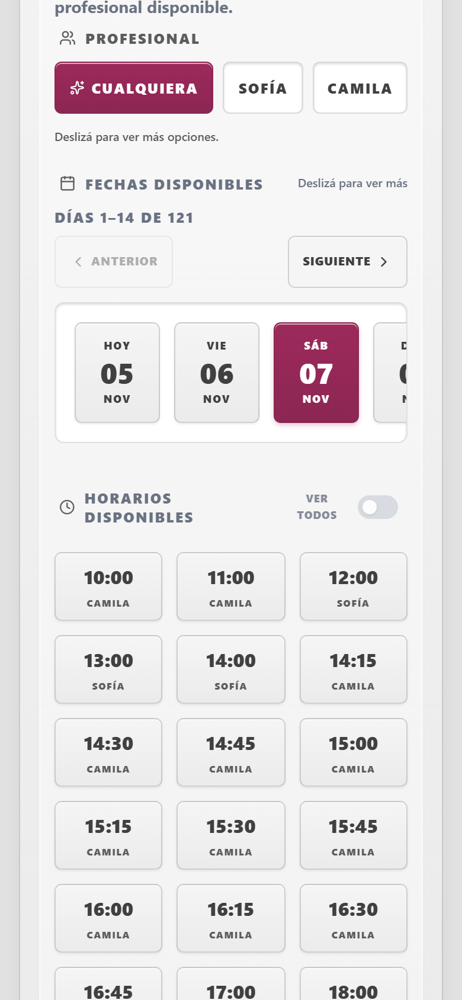
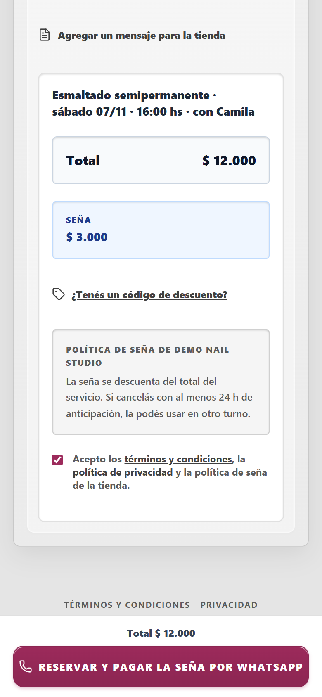
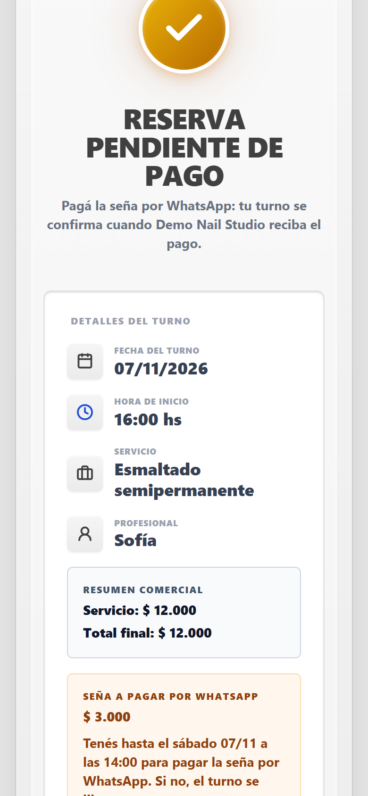
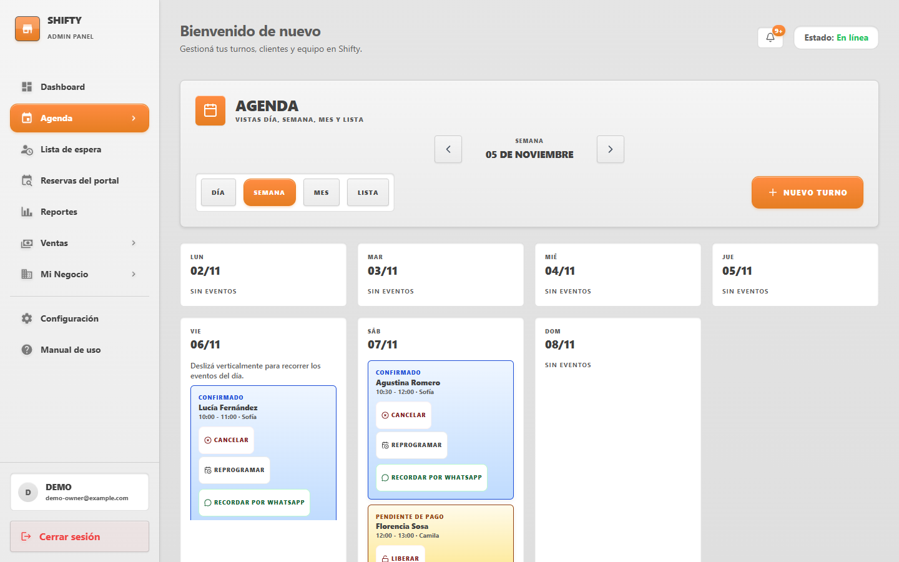
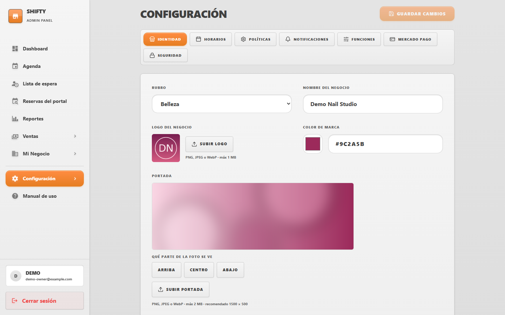

# Shifty

**Online booking with upfront deposits via Mercado Pago, built for small businesses such as nail salons, beauty studios, and barbershops.**

Website: [shifty-ar.tech](https://shifty-ar.tech)

---

## The problem

Small service businesses live on their calendar, and every empty slot costs money.

- **No-shows** leave paid hours empty, with no way to recover them.
- **Deposits are chased by hand.** Owners ask for a bank transfer over chat, wait for the receipt, and check it against the bank. That time comes out of serving clients.
- **Bookings live in chat threads**, which makes double bookings and forgotten appointments easy.

## The solution

Shifty gives each business its own booking page and an owner panel to run the day.

- **Booking flow.** The customer picks a service, a professional, and a time from real availability.
- **Upfront deposit.** When the service requires a deposit, the customer pays it with Mercado Pago. The slot is held while the payment is pending.
- **Automatic confirmation.** Once Mercado Pago reports the payment as approved, the appointment is confirmed and the customer gets a confirmation email. No one has to check a bank statement.
- **Deposit over WhatsApp, as an alternative.** A business can also take the deposit by transfer or cash arranged in a WhatsApp chat. The customer gets a click-to-chat link to the business's WhatsApp. Staff then mark the deposit as received in the panel, which confirms the appointment. This uses plain WhatsApp links, not the WhatsApp Business API. If the deposit is not recorded before its deadline, the slot is released.
- **Branded booking page.** Each business's page shows its own logo and brand color, so customers book with the business, not with a generic tool.

## My role

**Co-founder and full-stack developer.**

- Authored **135 of the 235 merged pull requests**, across bookings, payments, the owner panel, and security.
- Benchmarked **8 competitors** to define pricing.
- Worked on sales, taking the product to its first paying customer.

## Architecture

- **Frontend.** A React + TypeScript single-page app organized in layers (domain, application, infrastructure, presentation), served as a static build behind the edge.
- **Backend.** A FastAPI API organized by business module (bookings, payments, staff, catalog, and so on), moving toward a strict split between routing, business logic, and data access.
- **Background work.** Emails, reminders, payment follow-ups, and expiring unpaid holds run in Celery workers fed by a message broker and a scheduler, so slow or failing third parties never block a customer's request.
- **Cache and state kept apart.** A disposable Redis cache for availability, and a separate state store for protections such as rate limits, so evicting cache data can never weaken a protection.
- **Payments.** Each business connects its own Mercado Pago account through OAuth, so deposits go straight to the business.

## Key technical decisions

### The payment provider confirms the booking, not the browser

A customer returning from checkout proves nothing; redirects can be skipped, replayed, or forged. Shifty confirms a deposit only when Mercado Pago's webhook arrives, and even then it treats the webhook as a signal: it verifies the signature, then asks Mercado Pago directly for the payment and checks that it belongs to the right business and booking and matches the expected amount. Webhooks are stored and processed idempotently, so a repeated or late notification cannot confirm a booking twice.

### Double bookings are rejected by the database itself

Customers tapping the same slot at the same moment is the core race of a booking product. The application locks the relevant records before checking availability, and the database itself rejects any overlapping appointment for the same professional. If application code ever gets it wrong, the database still refuses the overlapping booking.

### Each business's data is isolated in the database

Shifty is multi-tenant: many businesses share one system. Isolation is enforced by row-level security in PostgreSQL, using a database role that cannot bypass it, and the application also scopes its queries to the current business as defense in depth. The business and role are always re-read from the database, never trusted from the session token alone.

### Layered protection against fake bookings and abuse

A public booking page is an open door, so protections are layered: optional verification codes sent by email, rate limits on sensitive actions, and bot detection on the booking form. In production, sensitive protections fail closed: if the system that enforces them is unavailable, the action is refused instead of let through.

### Safe, reversible deploys

CI builds versioned container images only after the quality pipeline passes. A deploy script pulls a specific version, runs database migrations while the previous version is still serving, and starts the new version next to the old one. Migrations are written so the running version never breaks: changes only add, and removals ship in a later release. A health gate checks the new release, and if it fails, the deploy rolls back automatically, without touching the database.

These decisions are backed by **8,000+ automated tests**, including tests that run against real PostgreSQL to cover locking, isolation, and migrations, and architecture tests that keep layer boundaries from eroding.

## Quality and security

Before launch, the product went through **2 audits** that produced **370+ findings**. **All high-priority findings were fixed.**

## Results

- **From idea to production in 10 months.**
- **First paying customer** using Shifty in production.

## Screenshots

A demo store with fictional data, captured on a local environment. More details in [`/screenshots`](./screenshots).

**Branded booking page**

**Booking flow on mobile:** booking page, picking a time, deposit over WhatsApp, and the pending-payment screen with its deadline.

  
  
  
  

**Owner panel: agenda**

**Owner panel: branding settings**

## Tech stack

- **Frontend:** React, TypeScript, Vite, TanStack Query, Tailwind CSS
- **Backend:** Python, FastAPI, SQLAlchemy, Celery
- **Data:** PostgreSQL, Redis, RabbitMQ
- **Infrastructure:** Docker, nginx, GitHub Actions
- **Integrations:** Mercado Pago, Sentry

---

*This repository is a case study and contains no product code. The product source code is available at [EnriqueMartinez26/shifty](https://github.com/EnriqueMartinez26/shifty).*
